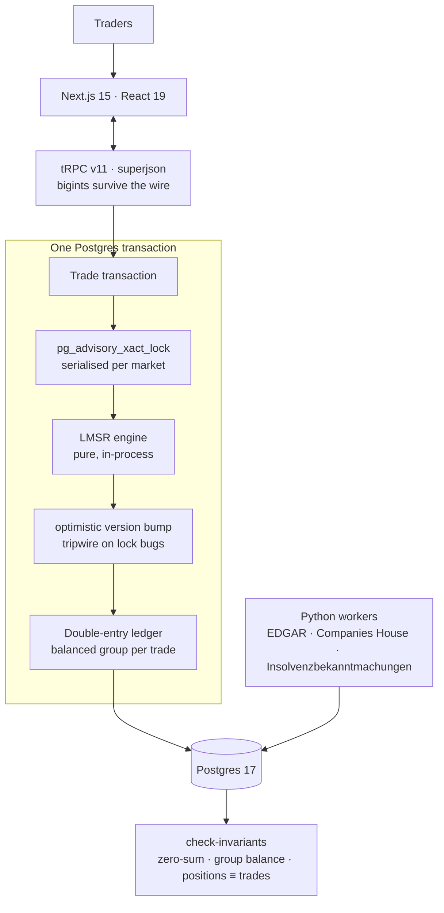

# PopOrSlop

**A play-money prediction market where every startup gets a token, a live price, and markets that settle against public records.**

🔗 **[poporslop.com](https://poporslop.com)** — live, open, and running the SummerUp winner market right now.

**Stack:** TypeScript · bigint fixed-point · vitest + fast-check    **Context:** SummerUp 2026 hackathon, Da Nang

---

## What it is

Ask a room of founders and investors who's going to raise, who's going to die, and who's going to win the hackathon — but instead of a poll, make them put something behind the answer. Prices move when people disagree. What you get is a number that means something: not "68% of respondents said yes", but "the market clears at 27%".

Points are given, never sold. There is no deposit, no withdrawal, and nothing redeemable. That constraint shaped everything below — with no real money to move, the only thing worth defending is that the numbers are *correct*.

Three surfaces run on the same engine:

- **Event markets** — 114 SummerUp teams as outcomes of one categorical market, repriced live as the room trades.
- **Startup markets** — funding, survival, exits, resolved against EDGAR, Companies House and the German insolvency register.
- **Startup tokens** — a bonding curve per listed company, so a startup's price is a continuous quantity rather than a binary bet.

## What's in this repo

**The market-maker engine** — [`engine/`](engine/). This is the real thing, not a sample: the exact code running in production, lifted out as a standalone package. Zero runtime dependencies, ~320 lines of source, ~350 lines of property tests.

The application around it — Next.js, tRPC, Postgres, the ingestion workers — is closed source. This repo is the part worth reading anyway: it's where the actual difficulty is.

## The problem the engine solves

A market maker has to quote a price for any trade, instantly, with nobody on the other side. We use **LMSR** (Hanson's logarithmic market scoring rule):

```
C(q) = b · ln( Σᵢ exp(qᵢ / b) )
pᵢ(q) = exp(qᵢ / b) / Σⱼ exp(qⱼ / b)
```

Cost of a trade is `C(q_after) − C(q_before)`. Prices always sum to 1, liquidity never runs out, and the house's worst-case loss is bounded by `b · ln(n)`.

That's the textbook part. The interesting part is making it survive contact with integers.

### Money is never a float

Every point and every share is a `bigint` in micro-units (10⁻⁶). Not in the database, not on the wire, not in the engine. A float64 point balance is a rounding error waiting to become a ledger discrepancy, and once your books don't balance you can't tell a bug from a theft.

The transcendentals still need floats — there's no sane fixed-point `exp` — so they run in float64 on the **dimensionless** ratios `qᵢ/b`, via log-sum-exp for numerical stability across any magnitude. Only the final µpt conversion crosses back into integers.

### Every rounding favours the house

At that boundary, buys round **up** and sells round **down**:

```ts
// engine/src/lmsr.ts — tradeCost()
return ceilToBigInt(b * (after - before));   // buyer pays ceil, seller receives floor
```

One µpt, every time. It sounds like a rounding detail; it's the whole security model. Without it, a trader can buy δ shares and immediately sell δ shares back and come out ahead by a fraction of a µpt — and anything a bot can repeat a million times is not a rounding error, it's a mint.

Someone probed exactly this on the live site: a scripted account placed matched buy/sell pairs at four different magnitudes, plus a 1-µshare sell to test whether a refund could round up. Every round trip lost exactly 1 µpt. That's this line doing its job.

### Payouts never touch a float

When a market resolves, one winning µshare pays exactly one µpt. Pure integer arithmetic, no `exp` anywhere near it. The one operation where a rounding error would be permanent and visible is the one operation that can't have one.

## What the property tests prove

Examples test the cases you thought of. These generate thousands of random market states and assert the invariants that have to hold for *all* of them — run with `fast-check`, 1,000 cases each in CI (200 locally by default; set `FC_NUM_RUNS` to change it).

| # | Property |
|---|---|
| 1 | **Path independence** — the same trades in any order reach an identical `q`; collected cost differs only by per-trade rounding |
| 2 | **No arbitrage** — buy δ then sell δ never profits the trader, from any reachable state |
| 3 | **Bounded loss** — the house never loses more than `b·ln(1/min prior)`, whichever outcome wins |
| 4 | **Price sanity** — every `p ∈ (0,1)`, µprobs sum to exactly 1e6, buying `i` raises `pᵢ` and never raises `pⱼ` |
| 5 | **Budget inversion** — `sharesForBudget` is maximal: the result fits, one more µshare doesn't |
| 6 | **Seeding** — opening prices reproduce the priors they were seeded from |

The bonding curve gets the same treatment, including **pool solvency**: selling every token back never withdraws more than was paid in.

Property 4's "sums to exactly 1e6" is worth a note — floats won't do that, so `pricesMicro` distributes the remainder by largest-remainder apportionment. A price row that displays as 99.9% is a bug report waiting to happen.

```bash
cd engine
npm install
npm test        # property suite
npm run typecheck
```

## How the rest fits together



**Concurrency.** Trades on one market are serialised by a Postgres advisory lock, with an optimistic `version` bump as a tripwire — if a future locking bug ever lets two trades interleave, the second one aborts loudly instead of silently corrupting `q`. The whole hot path is two reads and two writes.

**Correctness.** Every money movement is a balanced double-entry group. A standing check asserts global zero-sum, per-group balance, balance-cache reconciliation, and positions recomputed from the trade log. It runs after the test suite, after load tests, and after anything touched in production.

**Resolution.** Markets settle against public records, not opinions. Python workers ingest filings and propose drafts; they can *only* write oracle events and proposals. Every state transition and every ledger write happens in the TypeScript app — one writer per table class.

## Stack

TypeScript · Next.js 15 · React 19 · tRPC v11 · TanStack Query · Tailwind v4 · Postgres 17 · drizzle-orm · vitest + fast-check · Python 3.12 workers (httpx, lxml, psycopg3, rapidfuzz) · Docker on Coolify

---

MIT for `engine/`. The application is not open source.
